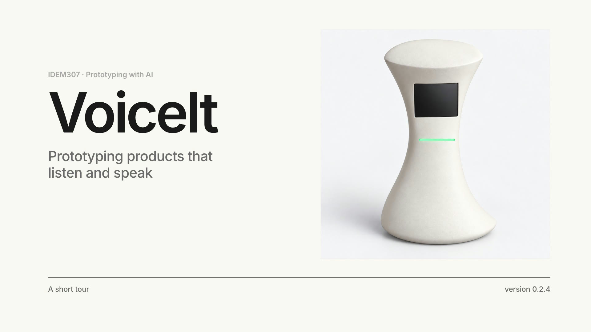
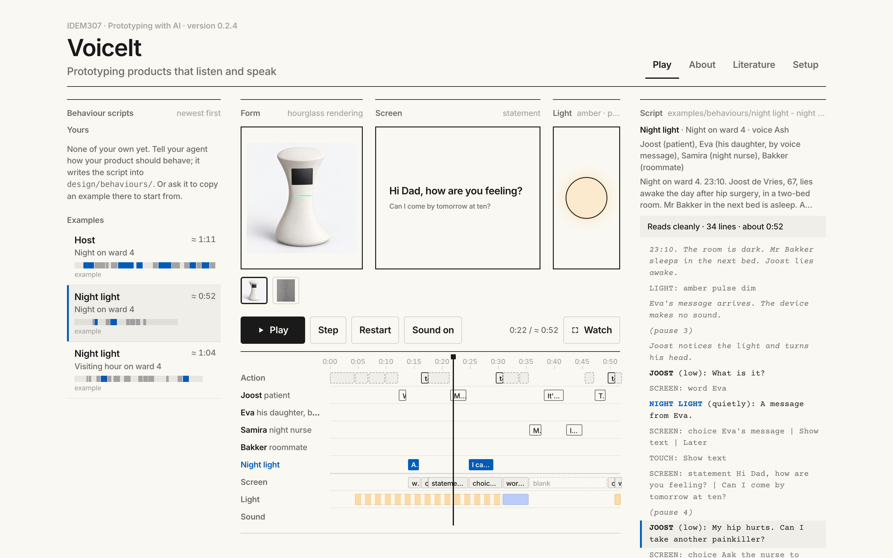
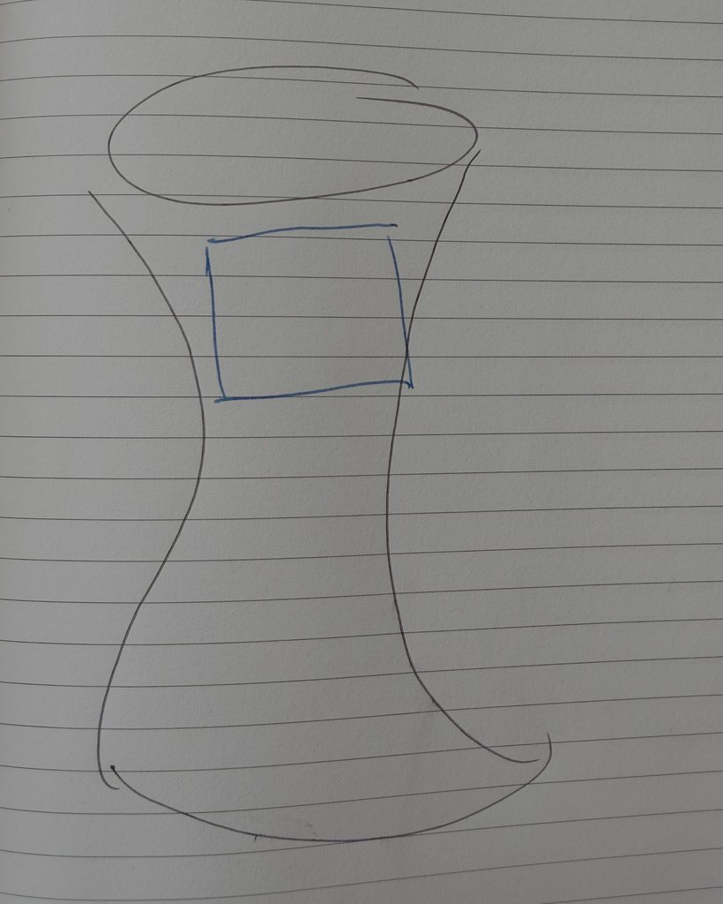
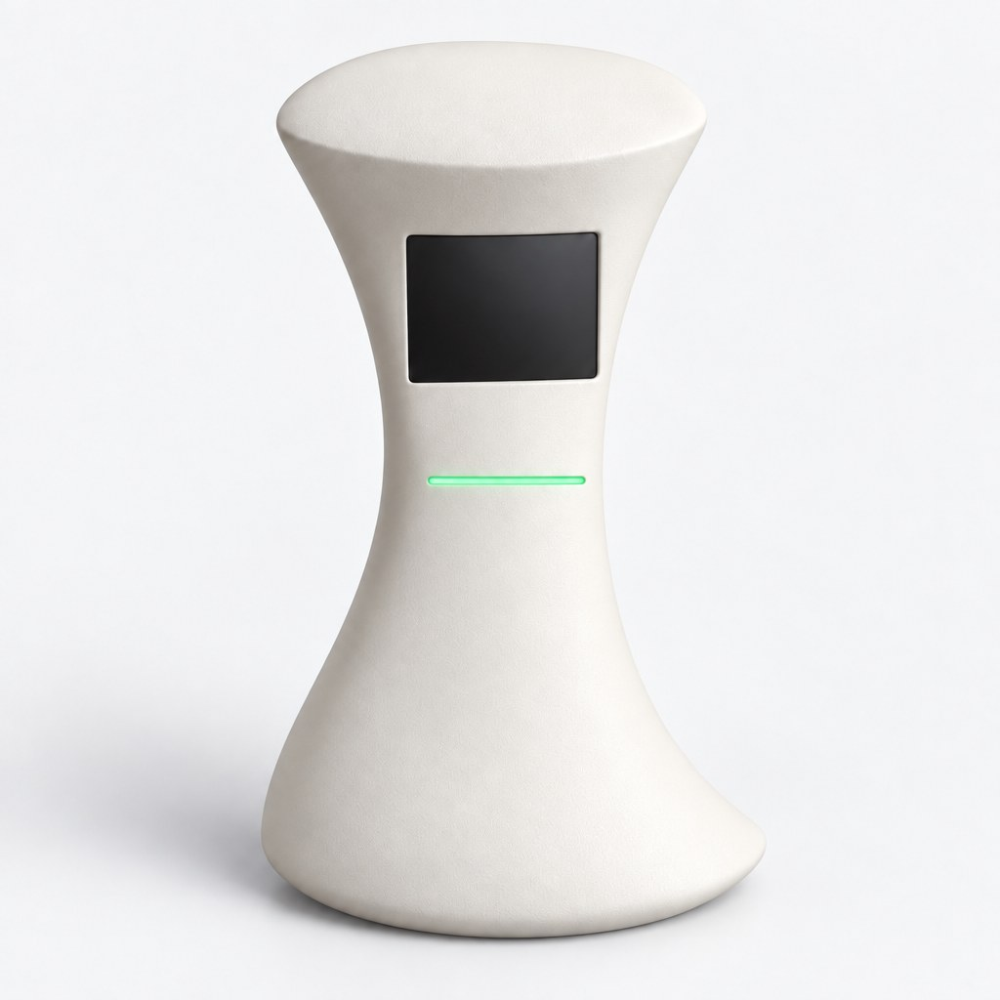

# VoiceIt

VoiceIt is a rapid prototyping tool for exploring how products such as smart speakers and voice assistants interact with people. It lets designers write and play scenarios that demonstrate a product’s proposed behaviour before building a working device. A scenario can include conversations involving several people, accompanied by screen messages, light signals and sound effects.

Designers write scripts themselves or describe the interaction to an AI coding assistant, which helps turn it into a script that VoiceIt can play in the browser. They can listen to the dialogue, inspect the sequence of events and revise the wording, voices or timing. An image represents the proposed physical design, allowing the same behaviour to be tried with different forms. All interactions are scripted, so designers can explore specific situations without implementing speech recognition or a live conversational system.

With VoiceIt, designers can make early design decisions that are difficult to assess through sketches alone. A smart speaker might offer useful advice but interrupt at the wrong moment, speak too formally or address the wrong person. By playing through these situations, designers can discuss how a product should respond and what role it should take. They can try several alternatives, evaluate the relationship between appearance and behaviour, and refine a concept before investing in hardware and software development.

## Start here

- **Understand the tool:** watch the tour below and look at the example script.
- **Make a prototype:** follow the [tutorial](TUTORIAL.md), with a text editor or an optional AI coding assistant.
- **Teach with it:** use the [classroom guide](CLASSROOM.md); its activities are optional, not requirements for using VoiceIt.
- **Adapt the tool:** see the [developer guide](DEVELOPING.md) for the code map, checks and contribution process.

VoiceIt playback needs no AI account or API key. The local version needs Node.js 18 or newer; there are no packages to install. An AI assistant or image generator, if you choose to use one while designing, is a separate service with its own terms and possible costs.

## Watch the tour

[](https://github.com/kortuem/voiceit/raw/main/media/voiceit-demo.mp4)

A short tour, with sound (click the image to download it, 7.5 MB): start VoiceIt, pick a script and a form, play it, inspect a moment, edit the script and play it again. The video is also in your copy of the repository, in `media/`, with subtitles (`voiceit-demo.srt`). Narration: ElevenLabs (elevenlabs.io), voice River.


*Smart speakers, one of them with a screen. Photo: Y2kcrazyjoker4, [CC BY-SA 4.0](https://creativecommons.org/licenses/by-sa/4.0/), via [Wikimedia Commons](https://commons.wikimedia.org/wiki/File:Google_Home_with_Home_Hub_and_Home_Mini_on_table.jpg).*



*VoiceIt playing the Night light example with the hourglass rendering as its form.*

## The VoiceIt interface

Select a behaviour script from the list and choose a product image for it from the thumbnails below the stage. The stage shows the product's form beside its current screen content and light. Press **Play** to watch and listen to the scenario, or **Watch** to enlarge the stage for presenting and discussing a design.

Use **Pause**, **Step** and **Restart** to examine particular moments. The timeline shows when each person and the product speak, together with screen changes, light signals and sounds. Click the timeline or a line in the script to move to that moment; the script highlights the line being played.

Try a different form with the same behaviour, or play another script to compare approaches. To change the dialogue or actions, ask your AI coding assistant or edit the script file. With the local preview running, saved changes appear in the browser within a few seconds. Online folder-refresh behaviour depends on the browser; see the note below.

## Form, behaviour and character

You design two things: the product's **form**, an image of the product, and its **behaviour**, written as a script. The product's **character** is the impression people form of who the product is when they play a behaviour with a form. You judge the character by playing; a script only gives it a name.

A behaviour script reads like a screenplay. The shortest example, *Timer · Pasta*, complete:

```
---
character: Timer
note: Pasta
voice: Mira
people: Tom (cooking, voice low)
---
# A kitchen, early evening. Tom set the timer for ten minutes of pasta and is chopping herbs.
The pasta boils. Tom chops herbs at the counter.
SOUND: chime
LIGHT: green pulse
SCREEN: choice Pasta: time's up | Stop | Another minute
DEVICE: The pasta timer is done.
Tom tastes a piece. Still a little hard.
TOUCH: Another minute
LIGHT: amber
SCREEN: word 1:00
DEVICE (quietly): One more minute.
TOM: Good.
```

Plain lines say what happens. A name in capitals speaks, with its manner in brackets; `DEVICE` is the product. `LIGHT`, `SCREEN` and `SOUND` are the product's light signals, screen content and sound effects; `TOUCH` is someone tapping the screen; `(pause 3)` is three seconds of silence. The lines between `---` are facts: the character's name, a note of your own, its voice and the people present; `#` lines describe the scene. The notation is in [system/SCREENPLAY.md](system/SCREENPLAY.md); the available screen components, lights, sounds and voices are in [system/VOCABULARY.md](system/VOCABULARY.md).

A form is an image of the product: a drawing or a rendered image, as PNG, JPG, WebP or SVG. A rough drawing can be enough to judge an interaction. [system/FORM.md](system/FORM.md) describes a way to develop one from a paper sketch with an image-generation tool.

## Try the examples

You need [Git](https://git-scm.com/downloads), [Node.js](https://nodejs.org) 18 or newer, and a browser. In a terminal:

```
git clone https://github.com/kortuem/voiceit.git
cd voiceit
node system/bin/preview
```

Your browser opens VoiceIt. Select an example in the list, choose a form below the stage, and press **Play**. `Ctrl+C` in the terminal stops VoiceIt. Without Node, the examples also play in [VoiceIt online](https://kortuem.github.io/voiceit/).

**Behaviour scripts**, in [examples/behaviours/](examples/behaviours/):

| File | Character | Scene |
| --- | --- | --- |
| `1 timer - pasta.md` | **Timer**: a kitchen timer | The pasta timer is done; Tom asks for another minute. Twelve seconds: speech, a choice on the screen, a touch and the light. |
| `2 lumo - call the nurse.md` | **Lumo**: quiet and prompt | Ward 4, 14:00: Joost asks Lumo to call the nurse. Lumo stays quiet while Samira is with him, and answers when she asks it to note what she gave him. |
| `3 night light - night on ward 4.md` | **Night light**: few words, spoken quietly; works through its light and screen | Night on ward 4: Joost lies awake after hip surgery, a message from his daughter arrives, and he wants to know whether he may take more pain relief. |
| `4 host - night on ward 4.md` | **Host**: talkative and helpful; says everything aloud | The same night, the same people and events. |
| `5 night light - visiting hour.md` | **Night light** | Visiting hour on ward 4: the same character in another scene. |

VoiceIt lists them in this order, simplest first. Play 3 and 4 one after another to hear two characters in the same scene; play 3 and 5 to see whether one character stays the same in two scenes.

**Forms**, in [examples/forms/](examples/forms/): a hand sketch of an hourglass-shaped speaker, and a rendering made from that sketch with an image-generation tool. Either can serve as a form.

 

## Design your own

Write behaviour scripts in any text editor, starting from a copy of an example and the [notation guide](system/SCREENPLAY.md). An AI coding assistant, such as Claude Code or Codex, can write, revise and check scripts with you; it is optional. For product images, use a drawing or photograph of a model, or use an image-generation tool to turn sketches into renders.

The [tutorial](TUTORIAL.md) takes you step by step: setting up, playing a short example, bringing in your product images, planning a scene on paper, writing and revising scripts, and judging them. Changing VoiceIt itself is an optional final step. The hospital scenes are worked examples, not a required project brief.

## Voices and timing

- Voices come from your browser and operating system, so they sound different on every laptop; durations (≈) are estimates. A script names a catalogue voice or voice register, not a particular installed voice. Available voices vary. VoiceIt guesses from the names of a laptop's voices which are low and which are high; where it guesses wrong, choose the laptop voice in the Setup tab. See the sound check in the [tutorial](TUTORIAL.md#1-set-up).
- Browsers: tested in Chrome on macOS. Not yet tested: Edge, Safari, Firefox, and anything on Windows.

## Files, speech and privacy

VoiceIt reads your scripts and images from your local project or a folder you select in the browser; it does not upload those files to a VoiceIt service. It does not save edits for you: edit and save the original files, and keep your own backups. Reloading the online version requires opening your folder again.

Speech uses the browser's speech-synthesis service. Some voices are local and others use an online service provided by the browser or operating system. Do not assume that spoken text always stays on the device. The page also requests fonts from Google Fonts. If you use an AI assistant or image generator to author material, anything you share with that service is governed separately. Use fictional or cleared material for demonstrations.

## Documentation

- [TUTORIAL.md](TUTORIAL.md): from set-up to your own scripts and a change to VoiceIt, step by step, and a reference.
- [system/SCREENPLAY.md](system/SCREENPLAY.md): the script notation and the checks.
- [system/VOCABULARY.md](system/VOCABULARY.md): screen components, lights, sounds, voices and manner.
- [system/FORM.md](system/FORM.md): from sketch to rendered form.
- [system/BOUNDARIES.md](system/BOUNDARIES.md): respectful representation when making scripts and forms.
- [CLASSROOM.md](CLASSROOM.md): optional group workflow and the original course exercise guidance.
- [DEVELOPING.md](DEVELOPING.md): architecture, local checks and contributing changes.
- [CHANGELOG.md](CHANGELOG.md): what changed from version to version.

## Folders

- [design/](design/) is yours: forms, behaviour scripts and notes.
- [examples/](examples/) holds the example scripts and forms. Leave them as they are; to start from one, copy it into `design/`.
- [media/](media/) holds the video tour.
- [system/](system/) is the tool: notation, vocabulary, procedures for the AI coding assistant, and VoiceIt itself.

**No Node, or it will not start?** Use **VoiceIt online**, [kortuem.github.io/voiceit](https://kortuem.github.io/voiceit/): the examples play at once. Click **Open your voiceit folder** in the list to play your own scripts; the files stay on your laptop. In Chrome and Edge, new and changed scripts then appear by themselves; in Safari and Firefox, open the folder again after a change. Your agent cannot run the check without Node; VoiceIt marks problems in the script column instead. Changes to VoiceIt itself run only with Node, in `node system/bin/preview`.

## Status and licence

Created by Gerd Kortuem · TU Delft. For IDEM307 — Generative AI and Design. Developed with OpenAI Codex and Anthropic Claude. Tour video produced with Claude; AI narration: ElevenLabs (elevenlabs.io).

VoiceIt began in the course IDEM307 at TU Delft and can be used independently for design practice, teaching and experimentation. This is version 0.5.1, an early release; what changed from version to version is in [CHANGELOG.md](CHANGELOG.md). Report problems in [GitHub Issues](https://github.com/kortuem/voiceit/issues) with your browser, operating system, VoiceIt version and a small fictional example that reproduces the problem. Do not post private project files or personal information. For maintainers: `node --test system/test/voiceit.test.js` runs the tests.

The code and the example files are under the [MIT licence](LICENSE). The smart speaker photo above is not part of the repository; it is shown from Wikimedia Commons under its own licence, CC BY-SA 4.0. Visual style after Vlak (vlak.dev) by Renn, Noord.
