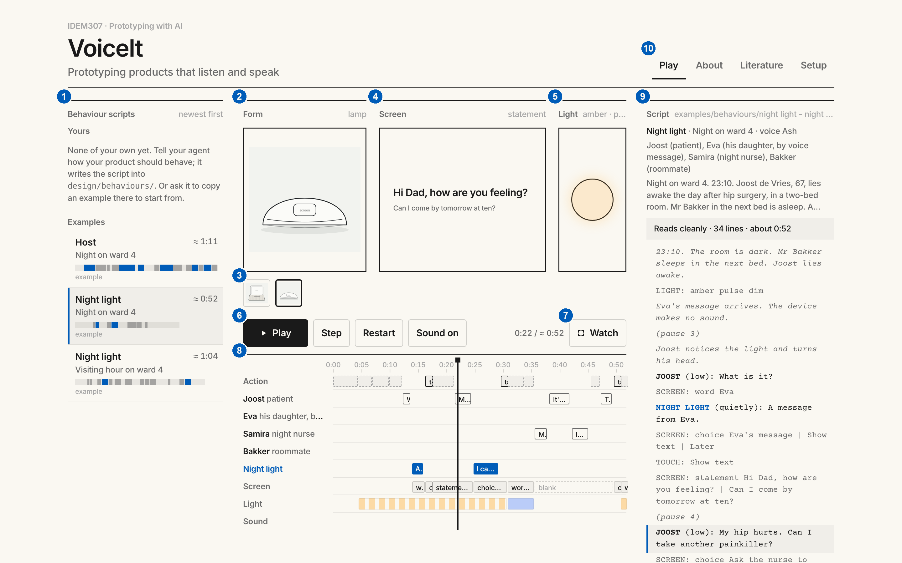

# VoiceIt tutorial

This tutorial takes you from setting up VoiceIt to behaviour scripts of your own, which you play, judge and demonstrate. It works for an individual designer or a team, with or without an AI coding assistant. The nine steps come first; changing the tool in step 9 is optional. A [reference](#reference) for later follows. Background on VoiceIt is in the [README](README.md); teaching activities are in the separate [classroom guide](CLASSROOM.md).

**In short:** set up (1) → play a short example (2, 3) → bring in your product images (4) → plan a scene on paper (5) → write a script, yourself or with an agent (6) → review and revise (7, 8) → optionally, change VoiceIt itself (9).

New to VoiceIt? [Watch the tour](https://github.com/kortuem/voiceit/raw/main/media/voiceit-demo.mp4) first (1 min 32 s, with sound; a 7.5 MB download, also in `media/` in your copy).

Quick reference: [phrases for the agent](#phrases-for-the-agent), [commands](#commands), [troubleshooting](#troubleshooting), and the script notation in [system/SCREENPLAY.md](system/SCREENPLAY.md).

## Words used here

| Term | Meaning |
| --- | --- |
| **Product** | What you design: a physical product that listens and speaks, such as a smart speaker. |
| **Form** | An image of the product: a drawing or a render. One file in `design/forms/`. |
| **Behaviour script** | How the product behaves in one scene: who says what, when, and what the product shows, lights and sounds. One file in `design/behaviours/`. "Script" for short. |
| **Character** | The impression of who the product is, formed by its form and its behaviour together. You do not write the character down: you judge it by playing a behaviour script with a form. A script only gives it a name (`character: Juno`). |
| **Agent** | An optional AI coding assistant, such as Claude Code or Codex, in a session on your `voiceit` folder. It writes, revises and checks behaviour scripts with you. It is not the simulated product. |
| **VoiceIt** | The page in your browser that plays behaviour scripts. |

## 1. Set up

For the local version, you need **Node.js 18 or newer** ([nodejs.org](https://nodejs.org), check with `node --version`), a browser and a text editor. **Git** is useful for downloading updates and saving versions, but you can download a ZIP instead. An AI coding assistant is optional; playback needs no AI account or API key.

1. **Make a folder for your design work**, for example `Documents/Design`.
2. **Get VoiceIt into it.** In a terminal in that folder, run `git clone https://github.com/kortuem/voiceit.git`. If you do not use Git, open the [repository](https://github.com/kortuem/voiceit), choose **Code → Download ZIP**, extract it and rename the extracted folder to `voiceit`. Already have a copy? Use that folder.
3. **If using an AI assistant**, open a session on the `voiceit` folder itself, not its parent. Claude Code and Codex can use the repository's instructions; a text editor needs no agent setup.
4. **For each new agent session, ask:**

   > Read AGENTS.md and follow it.

   Ask it to confirm that it has read the instructions. Skip this step if you are writing scripts yourself.
5. **Start VoiceIt.** Open a terminal in the `voiceit` folder and type `node system/bin/preview`. Your browser opens VoiceIt. Leave the terminal open while you work; `Ctrl+C` stops it. (No Node? See [Troubleshooting](#troubleshooting): VoiceIt also runs online.)

   <details><summary>Opening a terminal in the <code>voiceit</code> folder</summary>

   - **Mac:** open Terminal, type `cd ` (with a space), drag the `voiceit` folder onto the window, press Return.
   - **Windows:** open the `voiceit` folder in File Explorer, click the address bar, type `cmd`, press Enter.

   </details>
6. **Check the sound.** Open VoiceIt's **Setup** tab and press *Play the voices*. You hear each voice of the catalogue as your laptop plays it (fewer different ones if your laptop has only a few), and the checks under *Needed to play* say *Yes*. If a voice does not suit the part, choose another laptop voice for it in the table below the button. Speech may use a local or online voice service, depending on your browser and selected voice.
7. **Better voices (optional, takes a few minutes).** The standard voices sound robotic; better ones make the scripts much easier to judge. VoiceIt picks the best voices it finds by itself.
   - **Mac:** System Settings › Accessibility › Spoken Content › System voice › Manage Voices…. Under English, download a few voices marked **Premium** or **Enhanced**, for example Jamie, Daniel, Serena, Karen and Ava (low and high voices both help). Restart the browser, then play the voices again.
   - **Windows:** use **Microsoft Edge**, which offers natural-sounding online voices (their names end in "Natural"). More voices can be added under Settings › Time & language › Speech › Manage voices; not every added voice is available to the browser. (Not yet tested on Windows.)

## 2. Play an example

The list on the left starts with the shortest examples.

1. **Timer · Pasta** is selected when VoiceIt opens. Below the stage, click the hourglass rendering, then press **Play**. A kitchen timer chimes, its light pulses green, and the screen asks *Stop* or *Another minute*. Tom taps *Another minute*; the light turns amber and the timer says quietly: *"One more minute."* Twelve seconds: speech, a choice on the screen, a touch and the light.
2. Click **Lumo · Call the nurse** and press **Play**. Ward 4, 14:00: Joost asks Lumo to call the nurse. Lumo calls Samira and shows that she is on her way, stays quiet while she is with Joost, and answers when she asks it to note what she gave him.

The three longer examples are optional: the Night light and the Host in the same night on ward 4 (two products in one scene), and the Night light at visiting hour. Play them when you want to see a richer script.

## 3. The VoiceIt screen



1. **Behaviour scripts.** Your scripts, newest first, then the examples. Each row shows the character's name, the script's note, the approximate length, and the rhythm of the script (blue: the product speaks; grey: people speak).
2. **Form.** The product image currently shown.
3. **Form images.** All forms in `design/forms/` and the examples. Click one to show it with the selected script.
4. **Screen.** What the product shows on its screen at this moment.
5. **Light.** The product's light: its colour, and whether it pulses or is dimmed.
6. **Controls.** *Play* / *Pause*, *Step* (one line at a time), *Restart*, sound on and off, and the time.
7. **Watch.** Form, screen and light fill the window, for presenting. *Space* plays and pauses, the arrow keys step through the lines, *Escape* brings you back.
8. **Timeline.** The whole script over time: a lane for what happens, one lane per person, one for the product (blue), and lanes for screen, light and sound.
9. **Script.** The text of the script. The line being played is highlighted; problems are marked on their line.
10. **Tabs.** *Play*, *About* (background and the vocabulary), *Literature*, *Setup*.

Try it on Lumo:

- **Click the timeline** at about 0:12. The screen (4) shows *Samira is on her way*, the light (5) is amber, and the script (9) highlights *She's on her way. About two minutes.*
- **Press Step** a few times. Each press plays one line and stops.
- **Click a line in the script**, for example *SAMIRA: Lumo, note: pain six, paracetamol one gram.* Playback moves there.
- **Press Watch.** The stage fills the window, as you would show it to others.

## 4. Bring in your product images

Save your product images in `design/forms/`, one file for each product, named after it (for example `design/forms/juno.png`). PNG, JPG, WebP and SVG work.

1. Within a few seconds they appear among the form images (3), next to the example forms.
2. Click one to show it on the stage. Keep sketches and earlier versions in `design/forms/process/`; VoiceIt shows only the images directly in `design/forms/`.

(Developing an image from a sketch: [system/FORM.md](system/FORM.md).)

## 5. Plan the scene on paper

Plan the scene before writing a script or asking an agent to write it. Choose a setting relevant to your design. The hospital examples illustrate one setting; you do not have to use it. To compare products, plan a shared scene and let each product play it.

- **Who is there:** the people involved, each with a role and a suitable voice.
- **What happens, in order:** a handful of events.
- **Who says what, when and how:** the key lines, and how they are said (quietly, briskly).
- **What the product does** at each event: what it says, what it only shows on the screen, what its light does, and when it stays silent. If comparing alternatives, decide where their responses differ.

Keep it small: a scene of a minute or two is enough to judge a product's behaviour.

## 6. Let your agent write the scripts

**Without an agent:** copy an example from `examples/behaviours/` into `design/behaviours/` with a new filename. Edit the copy in a text editor, following [SCREENPLAY.md](system/SCREENPLAY.md) and [VOCABULARY.md](system/VOCABULARY.md). Keep the original example unchanged. Save, run `node system/bin/check`, fix errors and play the result. If you have no Node, read the problems marked in VoiceIt's script column instead. Continue with step 7.

**With an agent:** give it the plan, one product at a time. Start with **New behaviour script:**, then the product's name and the scene, then your plan. The following example uses the hospital setting; substitute your own setting and events. Ask it to keep to the plan:

> New behaviour script: Juno, night on ward 2. People: Joost (patient, voice low), Samira (night nurse, voice high). Plan: 1. Joost cannot sleep and asks Juno for the time. 2. Juno shows the time on the screen and says nothing. 3. Joost asks for the nurse. 4. Juno calls Samira quietly; its light pulses blue until she comes in. 5. While Samira is in the room, Juno is silent. Keep our events and their order; ask before adding anything.

You can also attach a photo of your paper plan; then check the read-back especially carefully.

1. The agent **reads back** what it understood: the name, the scene, the voice it proposes, and the events in order. Compare it with your plan; correct anything missing or added. Nothing is written yet.
2. Say **Go**. The agent writes the script into `design/behaviours/`, checks it, and tells you how long it plays and which decisions it made itself.
3. Within a few seconds the script appears at the top of the list in VoiceIt, marked *just now*. You do not need to reload the page. Click it and press **Play**.

To compare two products, a second one can play the same scene and plan with its own behaviour:

> New behaviour script: Rex, night on ward 2. The same people and plan as Juno, but Rex answers aloud, in a brisk voice, and tells Joost what the nurse will do.

## 7. Review the script

The script column (9) shows the script as it plays. A script file, which you can open in any text editor, looks like this (the first 18 lines of *Lumo · Call the nurse*):

```
---
character: Lumo
note: Call the nurse
voice: Noor
people: Joost (patient, voice low), Samira (nurse, voice high)
---
# Ward 4, 14:00. Joost de Vries, 67, the day after hip surgery, alone in his room.
# His pain is coming back. Lumo stands on his bedside table.
# Samira, the nurse, comes in. Before she leaves, she asks Lumo to note what she did.
14:00. Joost lies in bed. His face tightens.
LIGHT: white dim
JOOST (low): Lumo, my hip hurts. Can you get the nurse?
LIGHT: amber pulse
SCREEN: statement Calling the nurse | Samira, ward 4
DEVICE (quietly): I'm calling Samira.
(pause 2)
SCREEN: statement Samira is on her way | about 2 minutes
DEVICE (quietly): She's on her way. About two minutes.
```

The lines between `---` are facts: the character's name, its voice, a note of your own shown in the list, and the people present, each with a voice (`voice low`, `voice high` or a voice's name; without one, VoiceIt picks a free voice). The `#` lines are comments for the reader; they are not played. Then the script: what happens, who says what (the product speaks as `DEVICE`, or under its character's name), and what the product shows (`SCREEN`), lights (`LIGHT`) and sounds (`SOUND`). The notation is in [system/SCREENPLAY.md](system/SCREENPLAY.md); the screen components, light colours, sounds and voices are in [system/VOCABULARY.md](system/VOCABULARY.md) and in VoiceIt's About tab.

Read your script while it plays. Does it follow your plan? If an agent helped, did it add anything you did not ask for? Its report should name the decisions it made itself.

## 8. Revise the script

**Tell your agent what should change**, in your own words, and in which script:

> Juno talks while the nurse is in the room. It should wait until she has left.

The agent changes the script, checks it, and says what it changed. If your remark is about the character as a whole, it asks before changing the character's other scripts. The list shows the new version within a few seconds; play it again.

**Or edit the script yourself.** Open the file in `design/behaviours/` in any text editor, change a line and save. The local preview shows the new version within a few seconds. With Node, run `node system/bin/check` and fix errors before replaying. Without Node, read the problems marked in VoiceIt's script column; online, reopen your folder if your browser does not follow changes. If you use an agent, you can instead ask:

> Check our scripts.

The agent runs the check and explains what it finds, with line numbers, in plain words, and asks before fixing anything. Problems are also marked on their line in the script column (9).

**Check the fit.** Click a script, then an image among the form images (3): does this behaviour suit this appearance? Play it with other images too, and play your scripts one after another or compare their rhythm strips in the list. Look at the details: when does the product speak first, and when does it wait? How much does it say? Whom does it address? What does it keep off the loudspeaker? Change the form or the behaviour and play it again. To show a script to others, press **Watch**: form, screen and light fill the window; *Space* plays and pauses, *Escape* brings you back.

## 9. Optional: change VoiceIt itself

If you want to go further, you or your agent can change VoiceIt itself: add a feature, or change how something works. Changes like this run only in VoiceIt on your laptop (`node system/bin/preview`); VoiceIt online cannot run them. The [developer guide](DEVELOPING.md) explains the code and checks. The steps below describe working with an agent.

1. **Preserve a version first.** In a Git clone, review the files to include and ask *"Commit our work."* For a downloaded ZIP without Git, make a separate backup copy of the whole `voiceit` folder, including `design/`, before changing it. Keep the backup untouched so you can recover the tool and your own work.
2. **Ask for the change explicitly, as a change to VoiceIt:**

   > Change VoiceIt itself: add a sound called knock that plays two soft knocks. Keep our scripts working, and run the tests afterwards.

   Other ideas: a new light colour, a slower way of speaking, the product's name on the screen. VoiceIt's instructions let the agent change its own files only when you ask like this.
3. **Test it.** The agent runs VoiceIt's tests (`node --test system/test/voiceit.test.js`) and the check. Reload VoiceIt in the browser, try your change, and play your own scripts and an example: do they still play?
4. **If something broke:** ask the agent to identify and undo just its tool changes, preserving your scripts, images and any other work. Review the proposed recovery before it changes files.

# Reference

Look things up here while you work.

## Phrases for the agent

Four phrases cover the whole cycle. For everything else, say what you want in your own words.

| Say | When | Result |
| --- | --- | --- |
| **Read AGENTS.md and follow it.** | At the start of every session, as a safety net: the agent normally reads `AGENTS.md` by itself. | The agent reads VoiceIt's instructions and is ready. |
| **New behaviour script:** *name, scene, then your plan.* | To make a new script (step 6). | The agent reads back what it understood and waits. |
| **Go** | When the read-back is right. | The agent writes the script, checks it and reports. |
| **Check our scripts** | After you edited a script yourself, or when something does not play as expected. | The agent runs the check, explains what it finds with line numbers, and asks before fixing. |

To revise a script, just say what should change (step 8). To change VoiceIt itself, say so explicitly (step 9). The agent can also copy an example for you to start from, or compare a character's scripts, if you ask. Saving versions and tool updates are under Git, below.

## Commands

Type these in a terminal in the `voiceit` folder. Your agent runs the same commands for you when you ask.

| Command | What it does |
| --- | --- |
| `node system/bin/preview` | Starts VoiceIt and opens it in your browser. Leave it running; `Ctrl+C` stops it. |
| `node system/bin/preview --port 4400` | The same, on another port, if the usual one is taken. |
| `node system/bin/check` | Checks every behaviour script in `design/behaviours/` and the examples. |
| `node system/bin/check "design/behaviours/juno - visiting hour.md"` | Checks one script. Keep the quotes: file names contain spaces. |
| `node --test system/test/voiceit.test.js` | Runs VoiceIt's own tests, after a change to VoiceIt (step 9). |
| `git pull --no-rebase` | Brings updates into a Git clone (see below); not for a downloaded ZIP. |

The check prints one line per problem: the file, the line number, *error* or *warning*, and what to do. For example, after a few hand edits:

```
design/behaviours/juno - visiting hour.md:1  error    The front matter has no voice.
design/behaviours/juno - visiting hour.md:7  error    “pink” is not a light colour. LIGHT needs a colour: white, amber, blue, green, red, violet, or off.
design/behaviours/juno - visiting hour.md:9  warning  “Juno:” looks like a speaker. Names are written in capitals; this line is read as an action.
design/behaviours/juno - visiting hour.md:12  error    “(pause 2,5)”: write the number with a point, not a comma: (pause 2.5). Not played.
design/behaviours/juno - visiting hour.md:13  error    “choise” is not a screen component. Use word, statement, choice, image or blank. Shown as a statement.
design/behaviours/juno - visiting hour.md:16  error    “ding” is not a sound. Use chime, alert or click.
design/behaviours/juno - visiting hour.md:17  warning  OKAFOR speaks but is not in the people line (Anna, Daan, Lotte).

Checked 1 behaviour: 5 errors, 2 warnings.
```

Errors stop a line from playing as written; fix them. Warnings are worth reading; they usually mean the script will not play as you intended. VoiceIt marks the same problems on their lines in the script column. The full list of checks is under [Checks and warnings](system/SCREENPLAY.md#checks-and-warnings) in the notation.

## Saving versions with Git (optional)

**Git** is a version control system: it keeps the history of a folder. If you cloned VoiceIt, you have a copy of the repository and its history. Git works on that copy without a GitHub account. A downloaded ZIP has no Git history: keep backups of your `design/` folder, and do not run pull commands in it. To get a newer ZIP, extract it separately and copy your design files into the new copy; preserve your old folder, especially if you modified the tool.

A **commit** is a saved snapshot of tracked files at one moment, with a short message saying what changed ("first version of Juno"). Commits let you inspect earlier versions and try something without losing what worked. *Pull* brings new commits from the source repository into your clone; *push* sends your commits to a repository you can write to (only needed to share online, and needs an account). Local commits are not remote backups. Review what is included before committing or sharing; never publish private material merely to save a version.

You do not need any of this to use VoiceIt. Your agent can do each step for you when you ask:

- **Save a version:** *"Commit our work: first version of Juno."* The first time, Git asks for your name and e-mail.
- **See what changed:** *"What changed since our last commit?"*
- **Get tool updates in a clone:** save and review your work first, then *"Pull the latest VoiceIt."* (In a terminal: `git pull --no-rebase`.) This brings in changes to the tool, examples and documents. If there is a conflict, stop and review it; do not discard your work to make the update succeed.
- **Working as a group:** see the [classroom guide](CLASSROOM.md) for an optional single-laptop workflow.

## Troubleshooting

- **A new script does not appear:** is VoiceIt still running in its terminal? Is the file in `design/behaviours/` (not somewhere else)? Ask the agent: *"Where did you save it?"*
- **A script does not play as expected:** *"Check our scripts."* Problems are also marked in the script column (9).
- **Two people sound the same:** if the script column says so, your laptop has too few voices: download more (set-up step 7), or choose voices in the Setup tab. If the check warns that people share a voice, the script has more speakers than the catalogue has voices: let fewer people speak, as the warning says.
- **No sound:** is *Sound on* (6)? Test the voices and the sounds in the Setup tab; voices differ between browsers and systems. If the voices play but the sounds do not, reload the page (VoiceIt 0.2.10 or later is needed in Safari).
- **`node` is not found** right after installing Node.js: close the terminal and open a new one.
- **Node will not install, or VoiceIt will not start:** use [VoiceIt online](https://kortuem.github.io/voiceit/) as a backup. Click **Open your voiceit folder** in the list and choose your `voiceit` folder; the files stay on your laptop. Chrome and Edge follow the folder, so new scripts appear by themselves; in Safari and Firefox, open the folder again after a change. Your agent cannot run the check without Node, so read the problems VoiceIt marks in the script column. This is enough to write and play scripts; changing VoiceIt itself (step 9) needs Node.
- **The agent does not seem to know VoiceIt:** is the session on the `voiceit` folder itself? Say: *"Read AGENTS.md and follow it."*
